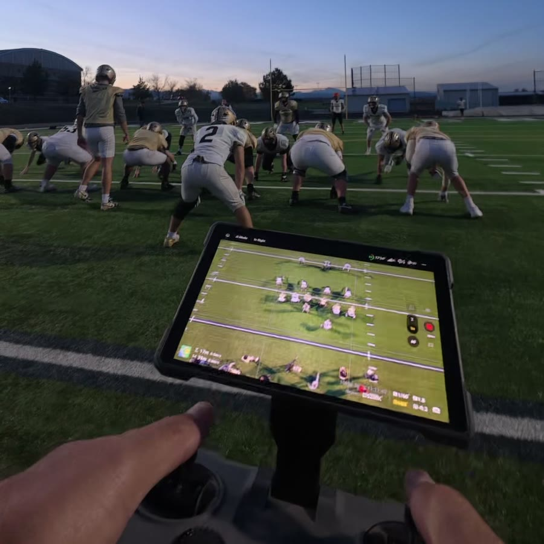

# Drone Replay

**See the play before the drone lands.**

We pay about $17,000 a year for Hudl. It still couldn't do the one thing I wanted at practice: show a coach the play we just ran, while the drone was still in the air.

So I built Drone Replay.

## How it works

1. **The pilot does nothing new.** They fly with a DJI RC Pro 2 controller and press Record and Stop, as they already do.
2. **About 3 seconds after Stop, the play is pulled from the controller to the device running the app,** which for now has to be an Android phone or tablet running Drone Replay.
3. **Coaches can use the phone in their pocket or a tablet (Android or iOS)** and scan the QR codes once per practice to get access to the replay clips.

## Does it work?

At our practices, October 18 to November 5, 2026:

- **1,013 plays** copied over Wi-Fi
- **0 lost**
- **3 seconds** (median) from Stop to the sideline

## What you need

- **A DJI RC Pro 2 controller.** For now, it's the only controller Drone Replay works with. Support for a single phone with DJI's RC-N1 controller is being worked on.
- **An Android phone or tablet** (Android 13 or newer, with 5 GHz Wi-Fi) to run Drone Replay on the sideline.
- **For the other coaches:** any phone or tablet with a web browser.

## What you don't need

- **No cases, cameras, tripods or power** to haul out
- **No network to build.** The tablet makes its own.
- **No subscription**
- **Nothing installed on the controller.** Drone Replay only reads the clips DJI Fly already saves there.

For comparison, a YoloBox Ultra alone lists for about $1,500, before any cameras. Sideline replay services run about $1,200 to $2,600 a year, plus hardware (list prices, November 2026).

## Pay what you want

If Drone Replay is worth something to your team, **[pay what you want](https://buy.stripe.com/9B6aEY7EnaLW64S2XFeAg00?client_reference_id=github)**.

- **You pick the amount.** $29 is suggested, and the minimum is $5.
- **It pays for the next release:** Drone Replay on one phone with DJI's RC-N1 controller, no tablet needed.
- **Leave your team's name or a shout-out** at checkout, and you might hear it in a future video.

Card statements show **KOMPARTNER\* DRONEREPLY**.

## Status

It's in use at practice with one team. The first public release, for Android with the DJI RC Pro 2, is coming.

To hear when it ships, click **Watch → Custom → Releases** at the top of this page.

Follow the build on Instagram **[@blwatson79](https://www.instagram.com/blwatson79/)** and on X **[@bwatson](https://x.com/bwatson)**.

---

Not affiliated with or endorsed by DJI.
